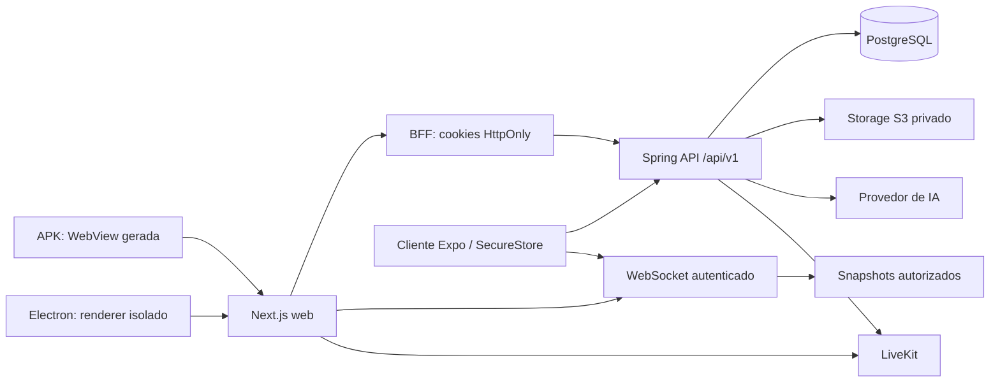

# Arquitetura — revisão de 28/10/2026

Monólito modular Java 21, Spring Boot 3.5, PostgreSQL, Flyway. Autenticação de usuários usa entidades JPA/repositórios; consultas transacionais de catálogo, salas e caronas usam JDBC parametrizado para tornar explícitos os locks e limites de autorização. Não são expostas entidades JPA nos controllers.

Módulos: auth emite e revoga sessões; academics mantém a árvore curricular; users gerencia matrícula; study controla salas/participantes; chat valida associação e persiste mensagens e anexos; voice fornece grants LiveKit para voz/câmera/tela; materials valida e armazena documentos; ai recupera chunks apenas da sala e integra a OpenAI Responses API; rides controla interesse/aceite; moderation aplica bloqueios e ações auditáveis. As dependências partem dos módulos consumidores para auth/common/study, sem dependência inversa do domínio para controllers ou SDKs.

Fronteiras externas: ObjectStorageService, VoiceProvider, AiProvider e PushNotificationService. EmailWorker processa outbox durável; envio SMTP ocorre após o commit que criou a conta. PushNotificationService entrega eventos após commit pelo Firebase Cloud Messaging HTTP v1 e respeita preferências por categoria. OAuth, filas de parsing e embeddings continuam como extensões não implementadas.

Tokens opacos permitem revogação das sessões API. JWT é usado nos grants LiveKit. O WS consulta snapshots autorizados do chat persistente de sala; digitação e conexões ficam em memória por processo. Conversas privadas cifram conteúdo no cliente, com custódia por conta recuperável pela API através de `CHAT_ACCOUNT_MASTER_KEY`; não são E2EE inacessíveis ao serviço. O banco armazena envelopes cifrados e a API entrega a proteção somente ao ator autenticado. Veja [Privacidade do chat](CHAT_PRIVACY.md).

O catálogo combina academic_entry com relações normalizadas de instituição, campus, oferta, grade, período, disciplina canônica e pré-requisitos. Providers oficiais versionados mantêm fonte/hash/auditoria. Grupos de optativas sem semestre são identificados como ELECTIVES e têm número nulo (V25).

CallSessionProvider e DesktopUpdateProvider vivem no layout raiz Web. O primeiro preserva a instância LiveKit e move o host visual entre sala e dock; o segundo usa somente a bridge restrita do preload. A implementação Expo possui NativeCallProvider; o APK WebView distribuído usa os providers Web e permissões da Activity gerada. Notificações e invalidações usam conexão autenticada separada das mensagens da sala.

Módulos community/learning/moderation acrescentam widgets, conquistas, registry de desafios e casos auditáveis. Concessões usam ledger e constraints únicas. Revisão por IA é opcional, assíncrona e não aplica sanções. Veja [COMMUNITY_V03](COMMUNITY_V03.md).

## Aprendizagem

O módulo `learning` registra progresso por desafio, ledger idempotente de XP, nível e sequência. A UI Web combina desafios progressivos com missão diária. O ledger evita premiação duplicada mesmo com retries concorrentes.

## Integrações externas atuais

- OpenAI Responses API: tutor com materiais e pesquisa web opcional com citações.
- LiveKit: voz, câmera e compartilhamento de tela no Web.
- S3/R2/MinIO: materiais persistentes enviados explicitamente para estudo.
- Firebase Cloud Messaging: push Android para mensagens, menções, fórum e demais categorias escolhidas pelo usuário.

---

## Fronteiras e limites atuais

A arquitetura do catálogo acadêmico é normalizada (com compatibilidade de `academic_entry`), não exclusivamente uma árvore simples. Os módulos de API atuais incluem `AcademicIdentityController`, `AccountPrivacyController`, `NotebookController`, `AppHelpController`, `ChatMediaController`, `PrivateCallController`, `RideController` e `RideSafetyController`. O banco evoluiu até **V65**. Esta revisão não acrescenta migrations.

Web: Next.js com BFF, WebSocket, Remotion e GIFs KLIPY via cliente; Mobile: Expo Router e shell WebView compartilhado; Desktop: Electron, NSIS, preload e IPC restritos. Armazenamento, IA, voz, notificações e mapas são serviços externos separados e demandam configuração e autorização própria.

Não declarar E2EE em salas, mídia de chamadas ou custódia privada recuperável pelo serviço. RLS de V62 impede acesso direto por papéis comuns sem políticas; proprietário/superusuário/BYPASSRLS podem ignorá-la. A política runtime preparada nesta revisão confia na API e não isola estudantes por linha. A autorização por dono/membro continua no Java. Flyway pode usar credenciais distintas das de runtime; a troca operacional depende de staging e prova do papel efetivo.

Os limites HTTP e a cota de IA usam PostgreSQL. `AiQuota` centraliza 40 tentativas/dia: execução direta consome antes do provedor numa transação independente, enquanto jobs reservam dentro da transação de enqueue. A geração adaptativa limita uma execução por usuário e duas por processo e chama o provedor fora da transação de persistência. Isso não constitui um semáforo distribuído.

Workers de cadernos reivindicam jobs com `SKIP LOCKED`. WebSocket mantém estado local e reconcilia snapshots autorizados; Redis declarado em infraestrutura não é evidência de coordenação implementada. Capacidade multi-réplica e dimensionamento de pools dependem de benchmark. A observação de CPU/memória sob baixa carga não prova escala.

O cliente Expo exige validação de `EXPO_PUBLIC_API_URL`: seu consumidor e `app.config.js` têm defaults diferentes; o caminho sugerido de proxy mobile não possui rota correspondente examinada. O builder oficial Android usa outro caminho, a WebView. Não distribuir um novo cliente Expo sem resolver e testar sua configuração efetiva.

Ver [Estado atual](STATUS.md), [Banco](DATABASE.md), [Segurança](SECURITY.md), [limites de readiness](PRODUCTION_READINESS.md) e [operação](OPERATIONS_READINESS.md).
